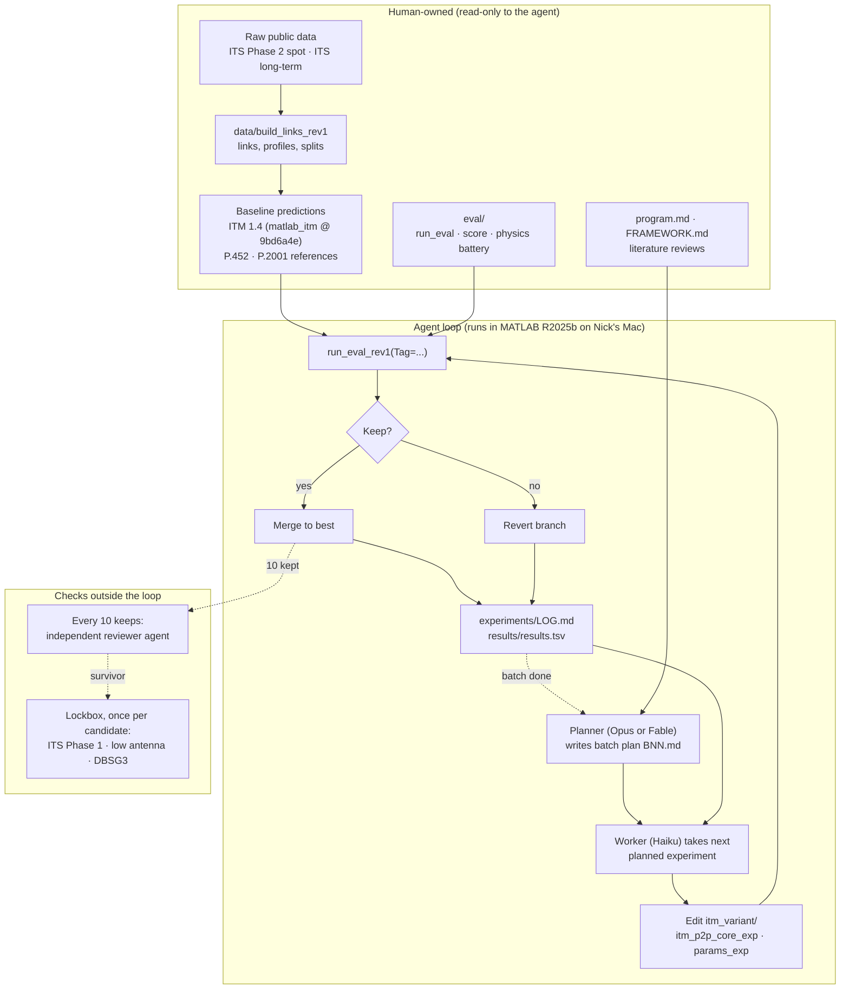

# ITM_ai_experiment

A sandbox for testing changes to the Irregular Terrain Model (ITM,
Longley-Rice) against measured propagation loss. An AI agent proposes
physically justified changes to a copy of the MATLAB ITM and keeps only the
ones that reduce error on held-out measurement sites.

- [docs/FLOW.md](docs/FLOW.md): flow diagrams of the system and of one
  experiment.
- [FRAMEWORK.md](FRAMEWORK.md): prior work, data, evaluation protocol,
  change catalog, experiment loop, guardrails, and roadmap.
- [program.md](program.md): the agent's standing instructions.
- [CLAUDE.md](CLAUDE.md): rules and commands for agents working here.
- [docs/LITERATURE_REVIEW.md](docs/LITERATURE_REVIEW.md): harness design,
  and replacement parts for ITM from P.452, P.2001, P.526, and the literature.
- [docs/AGENT_OPTIMIZATION_LITERATURE.md](docs/AGENT_OPTIMIZATION_LITERATURE.md):
  how agents are set up to optimize against a score, and how those loops fail.
- [docs/PUBLICATION_LITERATURE.md](docs/PUBLICATION_LITERATURE.md): could
  this be published; related work outside propagation and on AI with
  propagation models; venues and reporting rules.
- [docs/WORKING_PAPER_FINDINGS.md](docs/WORKING_PAPER_FINDINGS.md): what the
  ITM vs P.2001 vs P.452 working paper says to fix, as ranked hypotheses.
- [docs/PLAN_rev1.md](docs/PLAN_rev1.md): the working plan, stages and gates.
- [results/archive_rev1.txt](results/archive_rev1.txt): Pareto front and
  MAP-Elites cells of every eligible run.
- [docs/INDUSTRY_AGENT_PRACTICES.md](docs/INDUSTRY_AGENT_PRACTICES.md): how
  industry runs agents on self-checking systems (CI/CD, migrations,
  AlphaEvolve, EDA, telecom) and what this repo adopts.
- [experiments/LOG.md](experiments/LOG.md): one entry per experiment.
- [results/results.tsv](results/results.tsv): one row per experiment.

Baseline: [nicklasorte/matlab_itm](https://github.com/nicklasorte/matlab_itm),
a port of [NTIA/itm](https://github.com/NTIA/itm) that matches the C++
reference to within 4 × 10⁻¹³ dB.

Scored on ITS Phase 2 spot measurements (50 % time) and ITS long-term time
distributions (1 % to 99 % of time). Runs in MATLAB R2025b.

## How it works

More detail, including one experiment step by step: [docs/FLOW.md](docs/FLOW.md).

## Baseline

Experiment 000-baseline (RMS error in dB, lower is better; composite is the
mean of the other three):

| Model | Composite | Phase 2 cell-balanced | Long-term level | Long-term shape | Screened composite |
| --- | --- | --- | --- | --- | --- |
| ITM (baseline) | 16.0 | 18.3 | 24.6 | 5.2 | 13.4 |
| P.452 | 14.2 | 14.1 | 18.5 | 9.9 | 12.9 |
| P.2001 | 14.0 | 14.1 | 21.2 | 6.6 | 12.7 |
| ITM, constants refit within the physics and censored gates (R02, the comparator) | 15.9 | 18.3 | 24.4 | 5.1 | 13.3 |
| ITM, constants refit with no gates (R01; fails both gates) | 12.4 | 14.5 | 17.6 | 5.0 | 10.9 |

Phase 2 is 76–9190 MHz on 426 paths (ITM row RMS 16.7 dB). Long-term is
548 distributions on 325 paths worldwide, scored at the same 30 m terrain.
P.452 covers 0.001–50 % of time only, so its long-term scores use fewer
percentages. Censored-bound violations: ITM and R02 28.0 %, R01 55.9 %,
P.452 and P.2001 about 66 %. The screened composite leaves out 14 long-term
rows that the 1971 record calls line of sight but the 30 m profile blocks
(experiment D01); a kept change must improve both composites.
