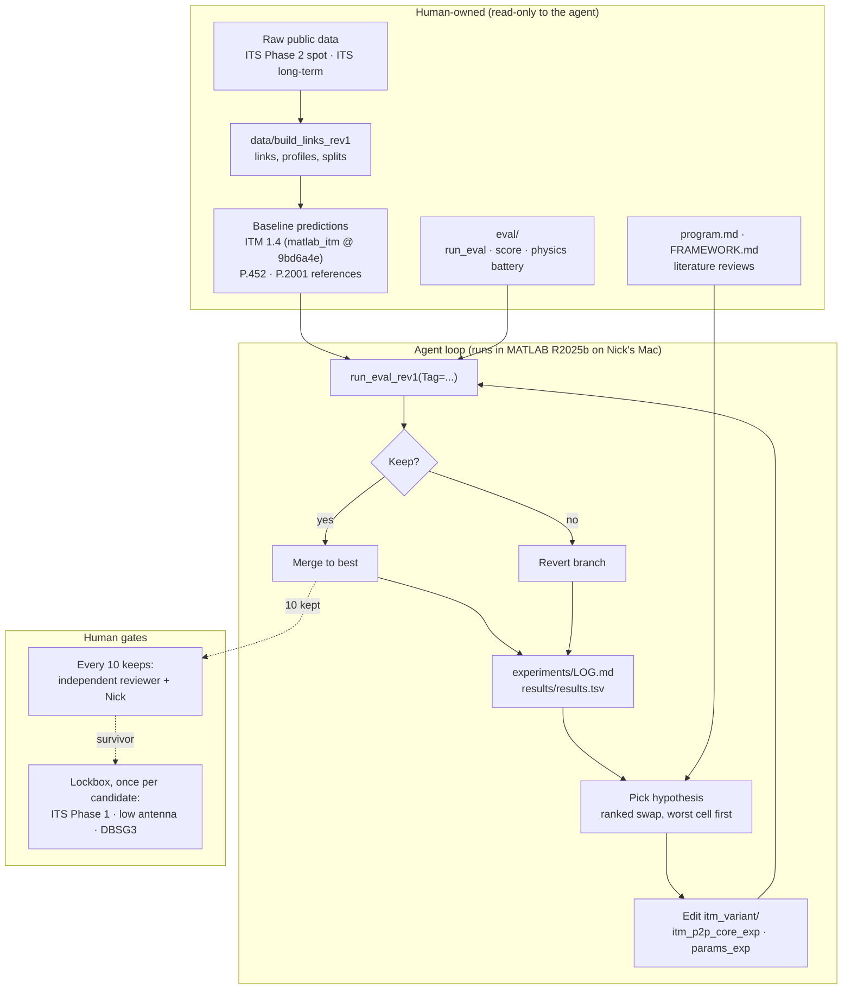
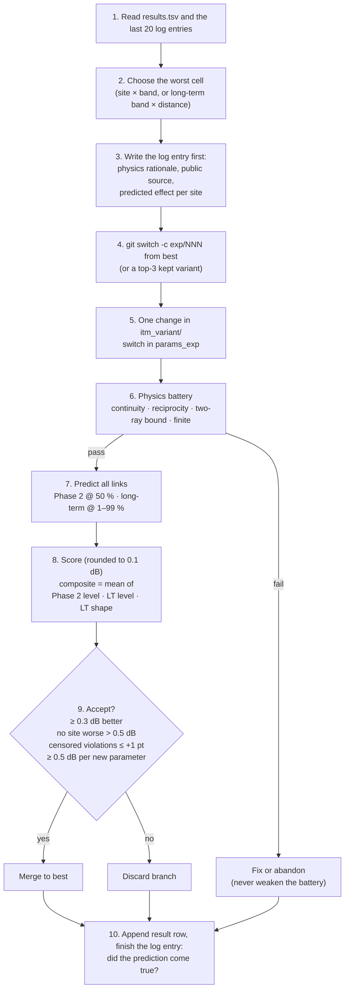

# How the framework works

Rev 1, 2026-11-21. Two views: the whole system, then one experiment in
detail. GitHub draws the diagrams from the Mermaid source below. The rules
behind each step are in [FRAMEWORK.md](../FRAMEWORK.md).

## The whole system

## One experiment

## Who owns what

| Area | Who edits it | Files |
| --- | --- | --- |
| Data and evaluator | Nick only | `data/`, `eval/` |
| Plan and instructions | Nick only | `FRAMEWORK.md`, `program.md`, `CLAUDE.md`, `docs/` |
| Model under test | Agent | `itm_variant/` |
| Record | Agent (append only) | `experiments/`, `results/` |
